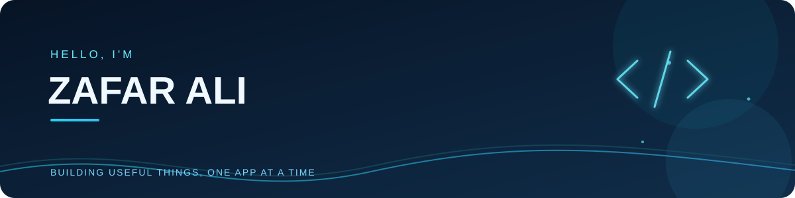
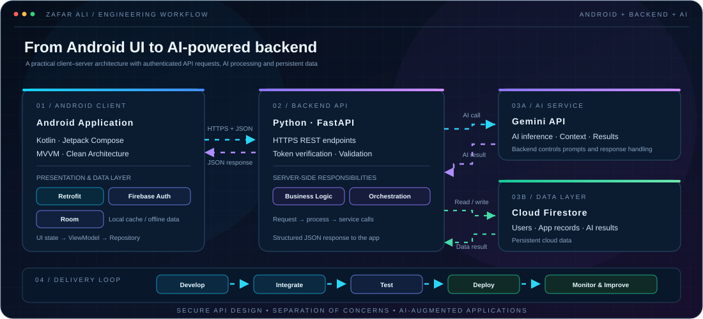
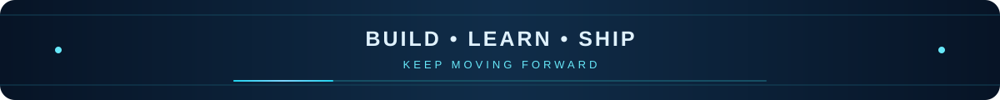

<!-- ========================================================= -->
<!-- ZAFAR ALI | CYAN EDITION                                  -->
<!-- ========================================================= -->

  

  

<!-- SOCIAL LINKS -->

&nbsp;

&nbsp;

&nbsp;

  

---

## 👨‍💻 About Me

<table>
<tr>
<td width="65%" valign="top">

### Hello, I'm Zafar Ali!

I'm a Software Engineering undergraduate at **MUET SZAB Campus**, passionate about Android development, software engineering, and building technology that solves real-world problems.

My primary focus is **Android application development using Kotlin and Jetpack Compose**. I enjoy transforming ideas into applications through modern UI development, clean architecture, API integration, and backend services.

Beyond coding, I contribute to technology initiatives, student leadership, entrepreneurship activities, and developer communities.

**I believe in learning by building and creating technology that makes a difference.**

</td>
<td width="35%" align="center" valign="middle">

 

**Zafar Ali**

📍 Sindh, Pakistan

🎓 Software Engineering

📱 Android Development

🚀 Product Building

</td>
</tr>
</table>

### Quick Overview

| | |
|---|---|
| 🎓 Education | BS Software Engineering — MUET SZAB Campus |
| 💻 Primary Focus | Android Development |
| ⚡ Main Language | Kotlin |
| 🎨 UI Development | Jetpack Compose, Material Design 3 |
| 🏗️ Architecture | MVVM, Clean Architecture |
| 🔥 Backend | Firebase, REST APIs |
| 🧠 Interests | Mobile AI, Product Development |
| ✍️ Writing | Technical articles on Medium |

---

## ✨ What I Do

<table>
<tr>
<td width="33%" align="center" valign="top">

### Kotlin Development

Building Android application logic and maintainable software.

</td>
<td width="33%" align="center" valign="top">

### Modern Android UI

Jetpack Compose, responsive layouts and Material Design 3.

</td>
<td width="33%" align="center" valign="top">

### Backend Integration

Firebase, authentication, APIs and application data.

</td>
</tr>
</table>

---

## 🎯 Current Focus

  

### My Development Direction

| Area | Current Focus |
|---|---|
| 📱 Android | Kotlin, Jetpack Compose, Material Design 3 |
| 🏗️ Architecture | MVVM, Clean Architecture, Repository Pattern |
| 🔌 Integration | Retrofit, REST APIs, Firebase |
| 💾 Database | Room, SQLite, Cloud Firestore |
| 🤖 AI | Exploring AI-assisted development and mobile AI applications |

> **My goal:** Build reliable Android applications with thoughtful architecture, useful features, and meaningful real-world applications.

---

## 🧰 Technology Stack

### 📱 Android Development

### 🏗️ Architecture & Libraries

### 🔥 Backend & Database

### 🛠️ Development Tools

### 🤖 AI-Assisted Development

Exploring AI-assisted development workflows to support coding, project implementation, debugging, and productivity.

  

---

## 🚀 Featured Projects

A selection of applications and product ideas I've worked on.

<table>
<tr>
<td width="50%" valign="top">

### 🐾 Scanimal

**AI Animal Identification & Digital Identity**

Animal identification through unique biometric patterns, with digital identity and ownership management concepts.

</td>
<td width="50%" valign="top">

### 📱 Federal Tax Filing

**Android Contract Project**

Remote contribution to a mobile application focused on federal tax filing workflows.

</td>
</tr>
<tr>
<td width="50%" valign="top">

### ₿ Crypto Currency App

**Cryptocurrency Information**

Android application integrating cryptocurrency data through the CoinGecko API.

</td>
<td width="50%" valign="top">

### 🌦️ Weather Application

**Weather Data & Mobile UI**

Android application exploring weather information through API integration and mobile interface development.

</td>
</tr>

</table>

---

## 💼 Professional Experience

<table>
<tr>
<td width="55" align="center" valign="top">

</td>
<td valign="top">

### Remote Android App Internship

August 2025 – October 2025

Practical experience in Android application development, UI implementation, and mobile development workflows.

</td>
</tr>
<tr>
<td width="55" align="center" valign="top">

</td>
<td valign="top">

### Remote Android Developer — Contract Project

Federal Tax Filing Mobile Application

Contributed to Android implementation and project development tasks in a remote development environment.

</td>
</tr>
</table>

---

## 🌍 Community & Leadership

Contributing beyond code through technology initiatives, student engagement, and collaboration.

<table>
<tr>
<td width="50%" valign="top">

### 🌐 GDG on Campus

**Former Community Lead**

MUET SZAB Campus

Led developer community activities, technical learning initiatives, student engagement, and collaborative learning opportunities.

</td>
<td width="50%" valign="top">

### 🚀 OptiSphere Network

**President — Sindh Chapter**

Leading regional community initiatives, technical sessions, and student engagement across Sindh.

</td>
</tr>
<tr>
<td width="50%" valign="top">

### 🏆 Hult Prize

**Marketing Lead — MUET SZAB**

Contributed to marketing, outreach, entrepreneurship initiatives, and student engagement.

</td>
<td width="50%" valign="top">

### ⚡ OpenHack'26

**Sponsor & Outreach Lead**

Contributed to sponsorship outreach, marketing, social media, and hackathon coordination.

</td>
</tr>

</tr>
</table>

---

## ✍️ Writing & Knowledge Sharing

I enjoy documenting technical learning, sharing development experiences, and exploring new technologies through writing.

---

## 📊 GitHub Statistics

  

  

---

## 🎯 What Drives Me

<table>
<tr>
<td width="33%" align="center">

### 💡 BUILD

Transform ideas into practical software products.

</td>
<td width="33%" align="center">

### 📚 LEARN

Keep exploring technologies and improving engineering skills.

</td>
<td width="33%" align="center">

### 🤝 CONTRIBUTE

Collaborate, share knowledge, and create opportunities.

</td>
</tr>
</table>

---

<!-- ========================================================= -->
<!-- ANIMATED FOOTER                                           -->
<!-- ========================================================= -->

  

### Let's Connect

&nbsp;

&nbsp;

&nbsp;

  

**Thanks for visiting my profile!**

  

